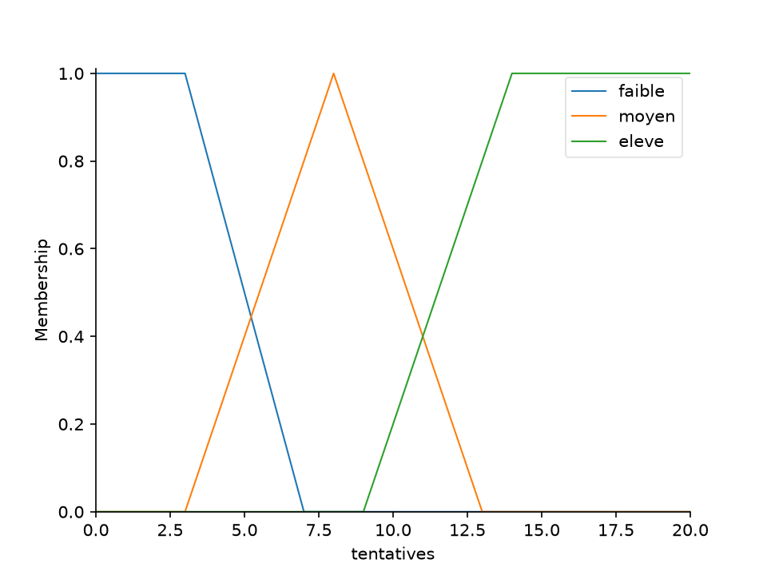
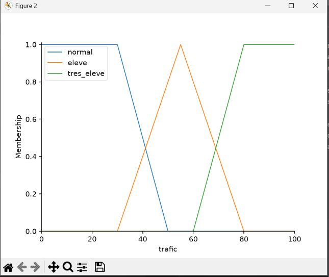
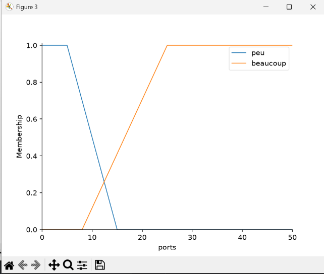
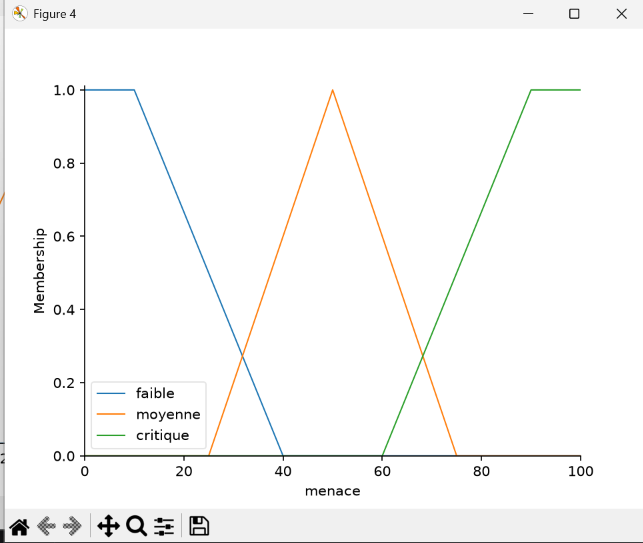
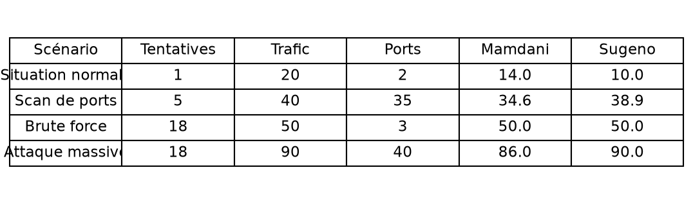
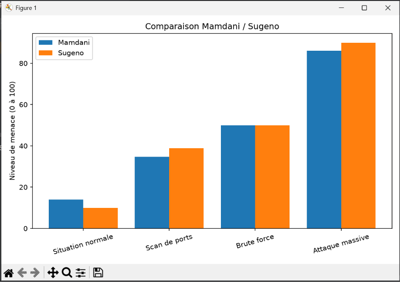
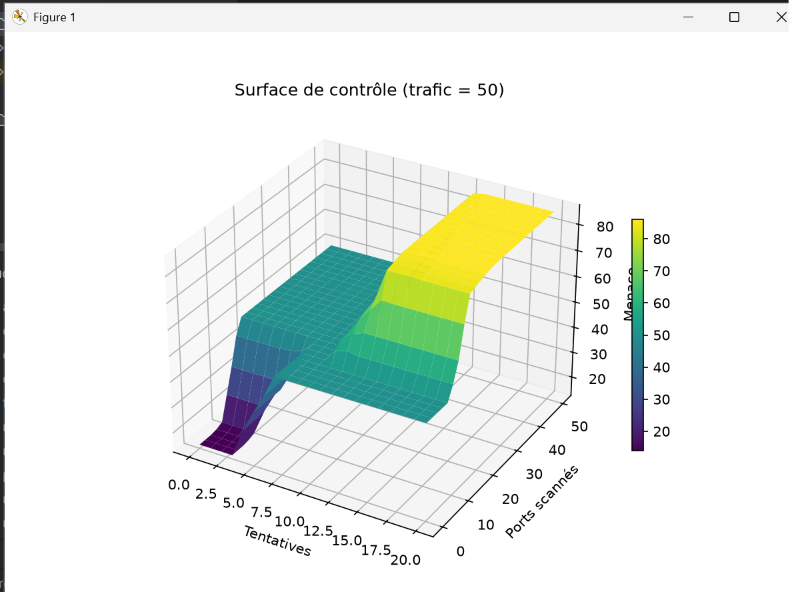

# Détection de menace réseau par logique floue

Projet de logique floue (LISI3, Faculté des Sciences de Sfax).
Système flou qui évalue le niveau de menace d'un réseau, avec deux méthodes : Mamdani et Sugeno.

## Variables

- Entrées :
  - tentatives de connexion échouées par minute [0, 20] : faible, moyen, élevé
  - trafic réseau en % [0, 100] : normal, élevé, très élevé
  - ports scannés par minute [0, 50] : peu, beaucoup
- Sortie : niveau de menace [0, 100] : faible, moyenne, critique

## Méthodes

- Mamdani : implication min, agrégation max, défuzzification par centre de gravité
- Sugeno : sorties constantes (10, 50, 90) et moyenne pondérée

La base contient 11 règles floues, communes aux deux méthodes.

## Installation

1. Installer les bibliothèques : `pip install -r requirements.txt`
2. Lancer le programme : `python fuzzy_menace.py`

## Résultats

### Fonctions d'appartenance

### Tests des scénarios

### Comparaison Mamdani / Sugeno

### Surface de contrôle

## Auteur

Yassine Machfer